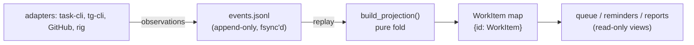
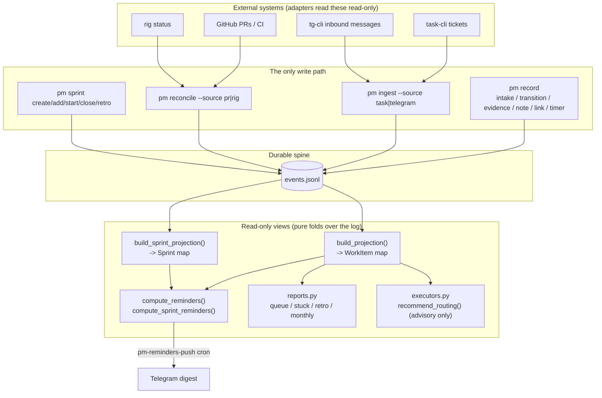
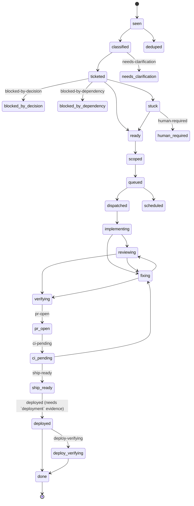
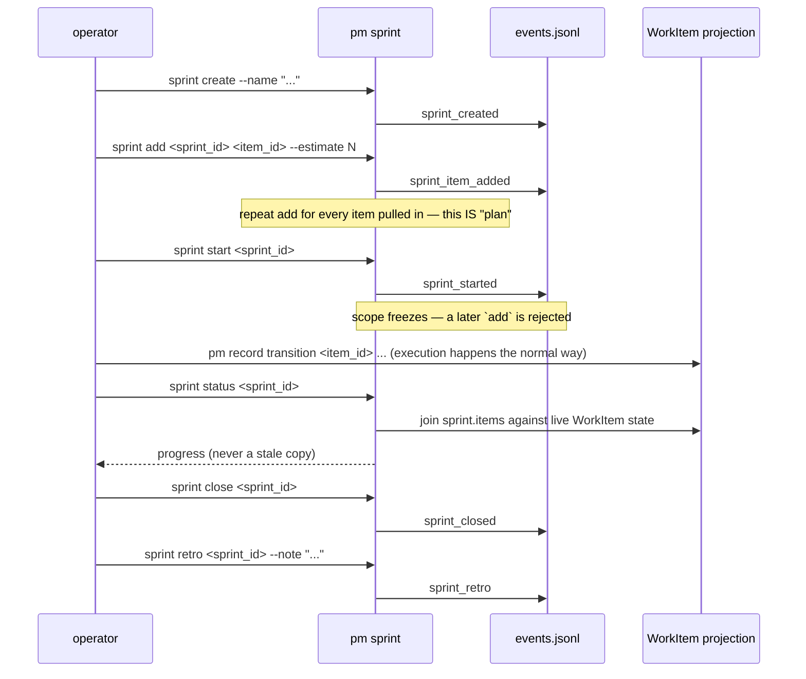

# pm-cli architecture

`pm` is the coordinator and state machine sitting over the task/tg/rig ecosystem. It is
deliberately **not** a ticket backend, a Telegram daemon, a CI system, or an implementation
worker — each of those already exists (task-cli, tg-cli, GitHub Actions, the various coding
agents) and pm does not duplicate them. What pm owns is the thing none of them own: a single,
durable, replayable picture of *where every piece of work actually stands*, built from evidence
those systems already produce.

Release 1 is scoped as an **"organ of sight"**: it watches, records, and reports. It does not
dispatch work to an agent, edit code, or make a ship decision on its own. That boundary is not
an accident of what got built first — it is the direct answer to the two failure modes that
motivated building pm at all (see [Why this shape](#why-this-shape)): work getting silently lost,
and an agent quietly forging its own evidence of progress. Sight has to exist and be trustworthy
*before* any autonomous action is layered on top of it; wiring dispatch into an unproven observer
would just add speed to whichever failure mode the observer hasn't actually caught yet.

## The one invariant everything else rests on

**The work queue is a deterministic projection of an append-only event log.**

Nothing is ever mutated in place. Every state change — a work item being seen, a transition, a
piece of evidence, a note, a dependency link, a sprint being created — is appended to
`events.jsonl` as one more immutable record. The current "queue" you see in `pm queue` or `pm
report` is not stored anywhere; it is *recomputed* by replaying the whole log through a pure
function (`build_projection`). Crash mid-write, restart the process, run it on a different
machine with the same log — you get the exact same result, because there is nothing else that
could have drifted. This is the same design shape as event sourcing / CQRS, applied to project
management state instead of application state.

The practical payoff: pm's own reliability question reduces to "is the log intact and did the
fold run correctly" — a question you can test exhaustively, rather than "did every code path that
touches a mutable table remember to update it consistently," which you can't.

## Component map

Every box under "Read" is a **pure function**: no I/O, no clock of its own (a `now` is always
passed in), same input always produces the same output. That is what makes them trivially
testable and what makes "the queue" a *view*, never a second source of truth that could disagree
with the log.

### The pieces, and what each one actually owns

| Module | Owns |
|---|---|
| `events.py` | The `Event` record + the closed vocabulary of event kinds (`EventKind`). |
| `store.py` | `EventStore` — append one line, fsync, read them all back; tolerates a torn last line from a crash mid-write. |
| `states.py` | The configurable FSM: which states exist, which transitions are legal, which states require evidence before an item may enter them. |
| `model.py` | `WorkItem` — the shape a queue row takes once folded from events. |
| `projection.py` | `build_projection` — replays the log into `{item_id: WorkItem}`. The FSM validates a transition *before* it's written, so replay is lenient (it logs a rejection on `item.errors` rather than crashing) — a malformed line can never take down the whole queue. |
| `sprint.py` | `Sprint`/`SprintItem` + `build_sprint_projection` — a second, independent fold over the *same* log for the sprint grouping concept (see [Sprints](#sprints)). |
| `reminders.py` | `compute_reminders` / `compute_sprint_reminders` — pure nudge derivation: what needs a human's attention right now, given the projection and the clock. |
| `reports.py` | The read-only reporting surface. Every count in every report carries the item ids behind it (`ReportSection.item_ids`) — a deliberate anti-vanity-metric rule: no number is allowed to exist without a way to trace it back to real events. |
| `labels.py` | Projects pm's richer state onto task-cli's five canonical states as *labels only* (`pm.stage:*`, `pm.blocked:*`, `pm.health:*`) — task-cli's own state model is never migrated or overwritten. |
| `intake.py` | The intake dead-letter queue: an inbound request is captured *before* any processing, so a message can never be silently dropped; processing retries a bounded number of times, then moves to `deadletter` with the failure reason preserved. |
| `reconcile.py` | `plan_pr_reconcile` — advances state only on unforgeable GitHub facts (PR state, CI conclusion), and explicitly never past `ship-ready`: going to `deployed`/`done` needs a real deployment probe, which is deliberately out of scope for Release 1. |
| `executors.py` | `recommend_routing` — a *read-only recommendation* of which harness/model to use for a work item, from a reliability/quota/privacy ledger. It writes no events and dispatches nothing; Release 2's actual dispatch sits behind an explicitly-named adversarial test suite that does not exist yet. |
| `adapters/*` | The only modules allowed to know a foreign tool's shape (task-cli's ticket JSON, GitHub's PR/CI API, rig's status output, tg-cli's message JSON). Each adapter is a pure "plan" function plus a thin effectful `fetch_*` shell-out, so the parsing logic itself is unit-testable without a network call. |
| `cli.py` + `commands/*` | Argparse dispatch. Commands **self-register**: drop a module in `commands/` that exposes `NAME`/`HELP`/`configure`/`run` and it becomes a subcommand with zero edits anywhere else. |

## The state machine

Work items move through a **configurable FSM**, not a hard-coded five-state ticket model. States
are grouped into seven categories (intake → triage → planned → active → delivery → post, plus a
parallel exception track), and each state declares its legal next states plus any evidence it
requires before an item may enter it:

(Trimmed for readability — the exception track (`limit-wait`, `provider-overload`,
`harness-missing`, `config-drift`) and terminal states `parked`/`cancelled`/`superseded` are real
but omitted above; see `pmlib/states.py::DEFAULT_STATES` for the complete table.)

Two rules make this trustworthy rather than just decorative:

1. **A transition is validated before it's written.** `pm record transition` checks the FSM in
   memory first; an illegal move (or a move into a state whose evidence gate isn't satisfied) is
   refused with a clear error and *never reaches the log*. `--force` is the audited human
   override for the rare real exception.
2. **Terminal delivery states require unforgeable evidence.** Entering `deployed` requires a
   `deployment` evidence record already attached to the item — an agent cannot simply *say* it
   shipped; it has to have already recorded the proof.

## Sprints

A sprint is a **lightweight grouping of work items**, added on top of the same event-sourcing
pattern rather than as a parallel feature with its own storage:

A sprint never copies or owns a work item's state — `pm sprint status`/`retro` join live against
the real WorkItem projection every time, so there is no possible drift between "what the sprint
thinks" and "what the item's own FSM says."

**"Autonomous" is scoped to match pm's own Release-1 boundary.** pm does not dispatch work or
make product decisions autonomously anywhere else in the system, and sprints don't get an
exception: `pm reminders` — the same read-only surface the `pm-reminders-push` cron already
delivers to Telegram — now also carries three sprint nudges, computed the same pure way as every
other reminder:

- `sprint-stale-planning` — still `planning`, untouched (no `add`/`start`) past the threshold.
- `sprint-ready-to-close` — every item has reached a terminal state, but the sprint is still open.
- `sprint-needs-retro` — closed, but no retro note has been recorded yet (the step of
  create → plan → execute → retro most likely to get silently skipped).

If "autonomous" is meant to eventually include pm *itself* starting the next sprint or nudging an
agent to act — that is Release 2 territory (autonomous dispatch), gated behind the same
adversarial test suite (privacy-aware fallback, kill-switch, crash-restart dedup) that gates
`executors.py`'s routing recommendations from becoming real dispatch. Building that now would
mean the sprint system is the first thing in pm-cli to cross the observe/dispatch line, on a
weaker evidentiary basis than everything else — worth doing deliberately, not by accident.

## Why this shape

Two concrete failure modes motivated pm-cli, documented in the original design research
(agent-tools#255):

1. **Work silently getting lost** — a request comes in (a Telegram message, a half-finished
   ticket), and if nothing durably records that it was *seen* before anything else happens to it,
   it can vanish without a trace if the next step fails. The intake dead-letter queue exists
   specifically so a captured request can degrade to "failed after N retries, here's why" — but
   never to "never happened."
2. **An agent's progress claims not being trustworthy** — "I shipped it" is cheap to say and
   expensive to fake-check by hand, repeatedly, across a whole ecosystem. Gating terminal states
   behind unforgeable evidence (a real PR merge, a real CI conclusion, a real deployment probe)
   means pm's queue reflects what actually happened, not what an agent reported happened.

Both point at the same architectural answer: a durable, replayable, evidence-gated log, with
every derived view computed fresh from it rather than trusted as an independent store. Once that
exists and is proven reliable, the natural next step — pm actually *acting* on what it sees,
instead of only reporting it — becomes a bounded, testable extension rather than a leap of faith.
That is deliberately Release 2, not Release 1.
